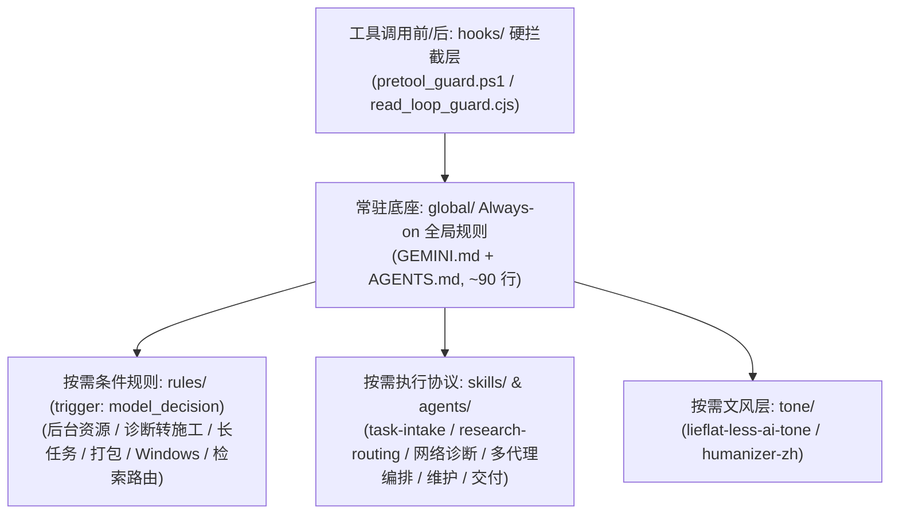

# Antigravity Agent Rules — 分层 Agent 治理与技能体系

一套面向 **Google Antigravity IDE / Gemini CLI / Claude Code** 等现代 Agentic Coding 环境的**分层治理规则、底层硬拦截 Hook、去 AI 味文风规范与按需执行 Skill 体系**。

> **历史溯源**：本套规则首版最早发布于 **百度贴吧·谷歌gemini吧（2026-09-29）**，由 **安钰** 在长期高频工程研发、跨端多代理协同与长程任务实战中持续迭代定型。感谢 **[LINUX DO 社区](https://linux.do/)** 的开源交流氛围与佬友支持。

---

> [!CAUTION]
> ### 醒目警告：不要把全部内容当成一个 Always-on 提示词加载！
>
> **严禁将本仓库所有 `.md` 文件拼接塞进同一个系统提示词（System Prompt / `GEMINI.md`）全量常驻加载！**
> 1. **注意力稀释与指令冲突**：大模型的有效注意力预算有限。如果把打包发布规则、长篇小说工作流、去 AI 味 30+ 条细则、工程四态状态机全部设为 `always_on`，日常聊一句简单问答也会触发繁琐的工程仪式，甚至导致核心安全红线被淹没。
> 2. **上下文窗口浪费**：全量常驻会白白吃掉数万 Token 的宝贵推理空间。
> 3. **正确用法是「按层按需加载」**：只有 `global/` 下的两个精简核心文件（约 90 行）常驻；高危命令交给 `hooks/` 在进程级拦截（0 Token 开销）；其余专项规则（`rules/`）、文风（`tone/`）与标准作业程序（`skills/`）一律由模型根据任务场景按需触发读取。

---

## 一、这套规则解决什么问题？

在重度使用 AI Agent 处理复杂代码工程、系统排障与文档交付时，单靠模型默认行为或散乱的 Prompt 往往会遇到以下典型失控模式：

1. **破坏性误操作与断网灾难**：Agent 在排查网络报错时擅自 kill 掉用户的代理客户端（Clash / Mihomo / Sing-box 等）、修改系统代理注册表，或执行 `rm -rf`、`git reset --hard` 覆盖未提交心血。
2. **只读调查死循环（Analysis Paralysis）**：用户已经要求修改代码、根因也已确认，Agent 却换着花样反复读取同一个文件区间、反复写探针脚本证明同一件事，迟迟不落刀施工。
3. **仪式化严谨与过度工程**：普通问答也套用故障排查模板编造“根因/回滚点”；顺手重构无关代码、清理无关 warning 导致 diff 污染。
4. **交付缩水与幻觉报喜**：要求交付完整功能或 Word 文档，却用“示意图/简化版/伪代码”冒充完成；只跑通一条静态路径就宣称“全量验证通过”（混淆 `VERIFIED` 与 `NOT_PROVEN`）。
5. **后台进程残留与主上下文污染**：随手拉起测试服务器、子进程或桌面 GUI 挂死在当前终端管道；把成千上万行的构建日志、哈希比对刷进主会话，导致主模型上下文迅速劣化。
6. **隐私泄露（开盒风险）**：在生成的脚本、报告、Word/PDF 元数据中硬编码本机系统用户名（`C:\Users\<用户名>\...`）或提交密钥凭据。
7. **机械翻译腔与浓重 AI 味**：写文章或润色文本时满篇“不仅……而且……”“总而言之”、排比三连、虚构细节或擅自篡改原文事实与语气确定度。

本仓库通过 **「进程级 Hook 硬拦截 → Always-on 极简宪法 → Model-Decision 条件路由 → Skill 按需加载 → Flash 子代理脏活隔离」** 五层架构系统性解决上述问题。

---

## 二、分层架构与全量文件总表



### 文件清单与触发矩阵

| 仓库内路径 | 原始部署路径（脱敏） | 所属层级 | 触发方式 | 一句话作用 |
| :--- | :--- | :--- | :--- | :--- |
| [`install.ps1`](./install.ps1) | 仓库根目录执行（一键部署入口） | 自动化部署 (`root`) | 手动执行（首次安装或更新规则时） | 预先校验 `config.json`/`hooks.json` 语法、列出待修改项并经 `y` 确认（支持 `-Force`）、自动备份原配置、替换 `<YOUR_PATH>`、按标记/顶层键无损合并 `GEMINI.md` 与 `hooks.json`、分发 5 层文件、启用 5 个插件并跑通 `verify-hook.py` 自检。 |
| [`uninstall.ps1`](./uninstall.ps1) | 仓库根目录执行（一键卸载回滚） | 自动化部署 (`root`) | 手动执行（卸载或还原配置时） | 经 `y` 确认后（支持 `-Force`），从最近一次 `backup_antigravity_rules_*` 还原安装前已存在的文件，删除安装前不存在的文件与插件目录，并仅从 `config.json` 移除本仓库的 5 个插件条目。 |
| [`hooks/hooks.json`](./hooks/hooks.json) | `~/.gemini/config/hooks.json` | 硬拦截 Hook (`hooks/`) | `PreToolUse` (`run_command`) / `PostToolUse` (读写检索工具) | 注册 `hard-gate` 危险命令硬拦截与 `read-loop` 重复读取检测钩子。 |
| [`hooks/scripts/pretool_guard.ps1`](./hooks/scripts/pretool_guard.ps1) | `~/.gemini/config/scripts/pretool_guard.ps1` | 硬拦截 Hook (`hooks/`) | `PreToolUse`（每次 `run_command` 执行前同步触发） | 底层正则硬拦截递归强删（含 `rm -r -f`、`--recursive --force`、PowerShell `rm/ri -r -fo` 等）、`git reset --hard`/`push --force`、删注册表/格式化，以及杀代理进程、停 TUN 服务、断网或改系统代理命令（UTF-8 流解码 + Fail-open 审计日志）。 |
| [`hooks/scripts/read_loop_guard.cjs`](./hooks/scripts/read_loop_guard.cjs) | `~/.gemini/config/scripts/read_loop_guard.cjs` | 硬拦截 Hook (`hooks/`) | `PostToolUse`（默认 `observe`）/ `PreToolUse`（`enforce` 未启用） | 监测同一会话内对未变更文件相同行号区间的重复读取。**默认仅运行在 `observe`（诊断观察）模式；`enforce`（阻断拦截）模式尚未验证（`read_loop_settings.json` 中 `nativeCoverageVerified`、`rangeOutputVerified`、`permissionPolicyVerified` 三个 Verified 标志均为 `false`），标 `NOT_PROVEN`**。 |
| [`hooks/scripts/read_loop_settings.json`](./hooks/scripts/read_loop_settings.json) | `~/.gemini/config/scripts/read_loop_settings.json` | 硬拦截 Hook (`hooks/`) | 被 `read_loop_guard.cjs` 读取 | 配置重复读取检测模式（默认 `"mode": "observe"`，三个 Verified 标志均为 `false`，`enforce` 模式 `NOT_PROVEN`）与重复次数上限（`repeatLimit: 3`）。 |
| [`hooks/scripts/verify-hook.py`](./hooks/scripts/verify-hook.py) + [`test-cases.txt`](./hooks/scripts/test-cases.txt) | `~/.gemini/config/scripts/` | 硬拦截 Hook (`hooks/`) | 手动执行（修改 `pretool_guard.ps1` 后运行自检） | 用含中文路径的真实 UTF-8 载荷、高危删改命令集与 VPN/代理/网络保护规则集（第 105–114 行）对 `pretool_guard.ps1` 做 40 项全量回归校验，确保拦截准确且无编码破损导致的静默放行。 |
| [`global/GEMINI.md`](./global/GEMINI.md) | `~/.gemini/GEMINI.md` | Always-on 全局规则 (`global/`) | `always_on`（所有会话自动注入） | 定义人机协作态度、防开盒与路径脱敏铁律、用户梯子/VPN 严格只读红线、Git Bash/pwsh 7 偏好、子代理派工原则与可选共享待办入口。 |
| [`global/AGENTS.md`](./global/AGENTS.md)（含 [`plugin.json`](./global/plugin.json)） | `~/.gemini/config/plugins/anyi-global-rules/rules/AGENTS.md` | Always-on 全局规则 (`global/`) | `trigger: always_on` | 全局工程主规则（§1–§15）：规定动作分级、`FAST_PATH`/`INVESTIGATION_PATH` 轮次纪律、禁仪式化严谨、停止与资源边界、交付契约、证据真实性、数据保护、范围锁定及按需专项路由。 |
| [`tone/lieflat-less-ai-tone/`](./tone/lieflat-less-ai-tone/skills/lieflat-less-ai-tone/SKILL.md) | `~/.gemini/config/plugins/lieflat-less-ai-tone/` | 文风层 (`tone/`) | 按需加载（创作或润色中文文章/文案/故事、或明确要求去 AI 味时；普通问答不加载） | 基于 283 万字语料统计的 11 条去 AI 味写作规范（与全局规则衔接版），清除宏大拔高、三连排比、翻译腔与连接词泛滥，严守事实与结构守恒（上游完整仓库见 [`UPSTREAM.md`](./tone/lieflat-less-ai-tone/UPSTREAM.md)）。 |
| [`tone/humanizer-zh/`](./tone/humanizer-zh/skills/humanizer-zh/SKILL.md) | `~/.gemini/config/plugins/humanizer-zh/` | 文风层 (`tone/`) | 按需加载（编辑或审阅已有中文文章/评论/文档、去除空话与模板化表达时） | 消除已有中文文本的空话、重复与模板腔，严格保留原文事实、确定程度与作者声音（上游仓库见 [`UPSTREAM.md`](./tone/humanizer-zh/UPSTREAM.md)）。 |
| [`rules/BACKGROUND-RESOURCES.md`](./rules/BACKGROUND-RESOURCES.md) | `~/.gemini/config/plugins/anyi-global-rules/rules/BACKGROUND-RESOURCES.md` | 按需 model-decision 规则 (`rules/`) | `trigger: model_decision`（创建/管理临时子代理、后台任务、测试服、子进程或拉起桌面 GUI 前） | 规定“谁创建谁负责生命周期”、创建记身份、探针用完即杀、桌面 GUI 脱钩启动，禁止按进程名盲杀用户原有服务。 |
| [`rules/IMPLEMENTATION.md`](./rules/IMPLEMENTATION.md) | `~/.gemini/config/plugins/anyi-global-rules/rules/IMPLEMENTATION.md` | 按需 model-decision 规则 (`rules/`) | `trigger: model_decision`（判断证据是否已收敛、能否从诊断转入施工时） | 细化全局 §2A 诊断→施工切换条件，区分故障修复根因证据与新增功能现状/目标证据，防止只读调查空转。 |
| [`rules/LONG-TASKS.md`](./rules/LONG-TASKS.md) | `~/.gemini/config/plugins/anyi-global-rules/rules/LONG-TASKS.md` | 按需 model-decision 规则 (`rules/`) | `trigger: model_decision`（距上次用户可见正文接近 8 分钟，或长任务卡点/重复失败时） | 细化全局 §4A 长任务阶段可见性（8 分钟墙钟阈值 / 60 次工具调用兜底），规范阶段汇报内容且不打断正常执行。 |
| [`rules/RELEASE-PACKAGING.md`](./rules/RELEASE-PACKAGING.md) | `~/.gemini/config/plugins/anyi-global-rules/rules/RELEASE-PACKAGING.md` | 按需 model-decision 规则 (`rules/`) | `trigger: model_decision`（构建、修改或验收 Release / 便携包 / 交付 ZIP 前） | 规定冻结基线定义、完整依赖闭包检查、独立新目录解压实跑验证与五态发布结论。 |
| [`rules/RULE-MAINTENANCE.md`](./rules/RULE-MAINTENANCE.md) | `~/.gemini/config/plugins/anyi-global-rules/rules/RULE-MAINTENANCE.md` | 按需 model-decision 规则 (`rules/`) | `trigger: model_decision`（新增、修改或评估本套全局治理规则时） | 细化全局 §14 规则冻结原则：禁止为单一失败样本扩写规则，明确新增条款必须同时满足的三项门槛。 |
| [`rules/WINDOWS-RELEASE.md`](./rules/WINDOWS-RELEASE.md) | `~/.gemini/config/plugins/anyi-global-rules/rules/WINDOWS-RELEASE.md` | 按需 model-decision 规则 (`rules/`) | `trigger: model_decision`（制作、修改或验证 Windows 脚本与中文交付物前） | 规范 BAT/CMD 纯 ASCII 编码、中文 TXT UTF-8 BOM 约定，以及启动/关闭脚本用目标解释器实跑验证的要求。 |
| [`rules/SEARCH-ROUTING.md`](./rules/SEARCH-ROUTING.md) | `~/.gemini/config/plugins/search-routing/rules/SEARCH-ROUTING.md` | 按需 model-decision 规则 (`rules/`) | `trigger: model_decision`（涉及时效信息、外部事实核验、库版本状态、官方文档或 URL 读取时） | 决定何时必须用 `search_web` 检索、何时用 `read_url_content` 直取、何时才用 Browser Agent 及失败降级规则。 |
| [`skills/task-intake/SKILL.md`](./skills/task-intake/SKILL.md) | `~/.gemini/config/plugins/anyi-global-rules/skills/task-intake/SKILL.md` | 按需 Skill (`skills/`) | 多步骤工程开发、复杂排障（`INVESTIGATION_PATH`）、生产变更、触发熔断或输出四态工程回报时 | 承载工程任务内部编译、状态标记总表（原全局 §7A）、只读空转熔断、独立 Review 与四态交付回报（`PASS`/`PASS_WITH_NOTES`/`BLOCKED`/`FAIL`）。 |
| [`skills/research-routing/SKILL.md`](./skills/research-routing/SKILL.md) | `~/.gemini/config/plugins/search-routing/skills/research-routing/SKILL.md` | 按需 Skill (`skills/`) | 触发 `SEARCH-ROUTING` 且需执行外部检索与多源核验时 | 规定双语查询构造、来源三级分类与交叉验证强度（第三方至少 2 独立源）、官方原文抓取与时效 `as-of` 标注 SOP。 |
| [`skills/safe-network-diagnostics/SKILL.md`](./skills/safe-network-diagnostics/SKILL.md) | `~/.gemini/config/plugins/anyi-global-rules/skills/safe-network-diagnostics/SKILL.md` | 按需 Skill (`skills/`) | 网络连通性排查、代理/梯子状态检查、DNS/端口探测或接口报错诊断时 | 固化用户代理只读红线，提供进程、端口、环境变量、连通性四步纯只读网络诊断命令规范。 |
| [`skills/multi-agent-orchestrator/SKILL.md`](./skills/multi-agent-orchestrator/SKILL.md) | `~/.gemini/config/plugins/anyi-global-rules/skills/multi-agent-orchestrator/SKILL.md` | 按需 Skill (`skills/`) | 子代理分工、派 Flash 干只读验证/脏活、跨模块检索、隔离实验或跨端 MCP 协同任务时 | 规范主会话上下文保护、内部 Subagent 模型/工作区选型（默认派 Flash 干只读活）、派工 Prompt 结构与跨端 MCP 协同纪律。 |
| [`skills/client-maintenance/SKILL.md`](./skills/client-maintenance/SKILL.md) | `<workspace>/.agents/skills/client-maintenance/SKILL.md` | 按需 Skill (`skills/`) | 清理 Antigravity 缓存、维护客户端存储空间或归档陈旧历史会话时 | 执行 7 天活跃会话与当前会话白名单保护、14 天以上陈旧会话压缩归档至 `_archives/` 并校验、以及临时渲染缓存安全释放。 |
| [`skills/docx-delivery/`](./skills/docx-delivery/skills/docx-delivery/SKILL.md) | `~/.gemini/config/plugins/docx-delivery/` | 按需 Skill (`skills/`) | 用户要求将 Markdown/文本/报告转换为可编辑的 Word (`.docx`) 成品时 | 提供两条实战验证的转换链（纯标准库无图版 `md2docx_one.py` / 带图版 `md2docx_img.py`）与防覆盖保护、结构校验脚本 `validate_docx.py`。 |
| [`skills/chinese-novelist/`](./skills/chinese-novelist/SKILL.md) | `<workspace>/.agents/skills/chinese-novelist/` | 按需 Skill (`skills/`) | 用户要求分章节创作中文中长篇小说（10–50 章）或续写小说项目时 | 与全局规则（§4A 阶段汇报、覆盖前备份、`lieflat-less-ai-tone` 自检）衔接的小说创作入口（上游完整流程与脚本见 [`UPSTREAM.md`](./skills/chinese-novelist/UPSTREAM.md)）。 |
| [`agents/flash-verifier.md`](./agents/flash-verifier.md) | `~/.gemini/config/plugins/anyi-global-rules/agents/flash-verifier.md` | 按需全局 Subagent (`agents/`) | `invoke_subagent(TypeName="flash-verifier")`（跑只读扫描、核对哈希、筛长日志时委派） | 运行在 Gemini Flash 上的全局只读验证专员定义，强制纯只读、单条回复 ≤40 行、大输出落盘 `scratch/`。 |

---

## 三、每层放到哪个目录、怎么启用？

### 方式一：一键自动部署脚本 `install.ps1`（推荐）

仓库根目录提供了纯 ASCII 编写的 [`install.ps1`](./install.ps1)（兼容 Windows PowerShell 5.1 与 `pwsh` 7），一条命令即可完成全量部署与自检：

```powershell
powershell -NoProfile -ExecutionPolicy Bypass -File .\install.ps1
# 如需跳过交互确认（自动化环境），可加 -Force：
# powershell -NoProfile -ExecutionPolicy Bypass -File .\install.ps1 -Force
```

脚本会依次执行以下安全步骤：
1. **前置语法校验（防半成品状态）**：在复制任何文件前，先解析现有的 `~/.gemini/config/config.json` 与 `hooks.json`；若解析失败（如含非法注释或语法错误）立即报错退出，绝不留下装了一半的状态；
2. **变更预览与确认**：开头列出 `~/.gemini` 下将被合并或覆盖的现有文件，要求用户输入 `y` 确认后才继续（默认否；加 `-Force` 可跳过确认）；
3. **自动快照备份**：将安装前已存在的目标文件完整备份至 `~/.gemini/backup_antigravity_rules_<timestamp>/`（同时记录 `manifest.json` 供卸载核对）；
4. **无损合并与路径替换**：
   - `GEMINI.md`：使用 `<!-- antigravity-agent-rules:begin -->` 与 `<!-- antigravity-agent-rules:end -->` 标记包裹本仓库规则追加到文件末尾（若已有标记则仅替换标记之间的内容，保留用户原有内容）；
   - `hooks.json`：按顶层键合并，仅新增或替换 `hard-gate`、`read-loop-efficiency`、`read-loop-enforcement` 三个键，保留用户原有的其他钩子配置；
   - 将 Markdown 规则中的 `<YOUR_PATH>` 自动替换为当前用户的 `$env:USERPROFILE` 正斜杠路径（如传入 `-WorkspacePath "D:\MyProject"`，还会同步替换 `<YOUR_PROJECT_PATH>`）；
5. **五层分发、插件启用与自检**：按标准插件目录结构分发全部 5 层文件，在 `config.json` 中启用 5 个插件，并自动运行 `python ~/.gemini/config/scripts/verify-hook.py` 验证 40 项断言全绿通过。

### 一键卸载与还原脚本 `uninstall.ps1`

如需卸载本套规则并恢复安装前状态，在仓库根目录运行 [`uninstall.ps1`](./uninstall.ps1)：

```powershell
powershell -NoProfile -ExecutionPolicy Bypass -File .\uninstall.ps1
```

卸载脚本列出待执行操作并经用户输入 `y` 确认后（支持 `-Force`）：
- 从最近一次 `~/.gemini/backup_antigravity_rules_*` 还原安装前已存在的文件；
- 删除安装前不存在的脚本文件与插件/技能目录；
- 在 `~/.gemini/config/config.json` 中仅移除本仓库所属的 5 个插件条目（`anyi-global-rules`、`search-routing`、`docx-delivery`、`lieflat-less-ai-tone`、`humanizer-zh`），保留其余配置。

> **关于 `global/AGENTS.md` 内相对链接的说明**：`global/AGENTS.md` 中的 `./IMPLEMENTATION.md`、`../skills/task-intake/SKILL.md` 等相对链接是按**部署后的运行目录层级**（`~/.gemini/config/plugins/anyi-global-rules/rules/AGENTS.md`）编写的，部署后完全正确；在 GitHub 网页端直接浏览仓库内 `global/AGENTS.md` 时因仓库按层分目录（`global/` 与 `rules/`、`skills/` 分离）点击会打不开，属正常现象。

---

### 方式二：按层手动部署

若需手动选择性部署，请先将文件中标注的 `<YOUR_PATH>`、`<YOUR_PROJECT_PATH>` 等占位符替换为你本机的实际路径（或直接改用 `~` 相对路径）。

#### 1. 底层硬拦截层（`hooks/`）
- **目标位置**：
  - 将 `hooks/hooks.json` 放入 `~/.gemini/config/hooks.json`
  - 将 `hooks/scripts/*` 放入 `~/.gemini/config/scripts/`
- **路径与环境要求**：
  - `hooks.json` 中的 `hard-gate` 与 `read-loop` 已统一使用基于 `hooks.json` 所在目录（`~/.gemini/config/`）的相对路径 `./scripts/pretool_guard.ps1` 与 `./scripts/read_loop_guard.cjs`（已在本机实测验证生效）。
  - `read-loop` 直接调用 `node` 命令，要求 `node`（Node.js）已加入系统 `PATH` 环境变量。
- **启用与验证**：
  - 在终端运行自检脚本验证拦截器工作正常（共 40 项断言，含高危删改、中文路径编码回归、杀梯子/停代理/改系统代理注册表拦截与无状态放行验证）：
    ```bash
    python ~/.gemini/config/scripts/verify-hook.py
    ```

#### 2. Always-on 全局规则层（`global/`）
- **目标位置**：
  - `global/GEMINI.md` → 复制到 `~/.gemini/GEMINI.md`
  - `global/plugin.json` → 复制到 `~/.gemini/config/plugins/anyi-global-rules/plugin.json`
  - `global/AGENTS.md` → 复制到 `~/.gemini/config/plugins/anyi-global-rules/rules/AGENTS.md`
- **启用方式**：
  - `~/.gemini/GEMINI.md` 会被 Antigravity / Gemini 自动作为全局最高优 `user_global` 规则注入。
  - 在 `~/.gemini/config/config.json` 的 `"plugins"` 字段下启用插件：
    ```json
    "anyi-global-rules": {
      "enabled": true
    }
    ```

#### 3. 按需 `model_decision` 专项规则层（`rules/`）
- **目标位置**：
  - `BACKGROUND-RESOURCES.md`、`IMPLEMENTATION.md`、`LONG-TASKS.md`、`RELEASE-PACKAGING.md`、`RULE-MAINTENANCE.md`、`WINDOWS-RELEASE.md` → 放入 `~/.gemini/config/plugins/anyi-global-rules/rules/`
  - `SEARCH-ROUTING.md` → 放入 `~/.gemini/config/plugins/search-routing/rules/SEARCH-ROUTING.md`（并将 `rules/search-routing.plugin.json` 命名为 `~/.gemini/config/plugins/search-routing/plugin.json`，在 `config.json` 中设为 `"enabled": true`）
- **启用方式**：
  - 这些文件顶部均带有 YAML Frontmatter `trigger: model_decision` 与精确的 `description`。Antigravity 平时只向模型暴露一行触发描述，仅当任务命中条件时由模型按需调用 `read_file` 加载全文。

#### 4. 按需 Skill 与全局 Subagent 层（`skills/` & `agents/`）
- **目标位置**：
  - `task-intake/`、`safe-network-diagnostics/`、`multi-agent-orchestrator/` → 放入 `~/.gemini/config/plugins/anyi-global-rules/skills/`
  - `research-routing/` → 放入 `~/.gemini/config/plugins/search-routing/skills/research-routing/`
  - `docx-delivery/` → 原样放入 `~/.gemini/config/plugins/docx-delivery/`（目录内已按 `plugin.json` + `skills/docx-delivery/SKILL.md` + `skills/docx-delivery/scripts/` 标准插件层级组织，在 `config.json` 中启用即可）
  - `client-maintenance/`、`chinese-novelist/` → 可放入工作区 `.agents/skills/` 或全局 `~/.gemini/antigravity/skills/`（注：`chinese-novelist` 需先按其 `UPSTREAM.md` 拉取上游 `references/` 与 `scripts/`）
  - `agents/flash-verifier.md` → 放入 `~/.gemini/config/plugins/anyi-global-rules/agents/flash-verifier.md`

#### 5. 去 AI 味文风层（`tone/`）
- **目标位置**：
  - `tone/lieflat-less-ai-tone/` → 原样放入 `~/.gemini/config/plugins/lieflat-less-ai-tone/`（目录内已按 `plugin.json` + `skills/lieflat-less-ai-tone/SKILL.md` 标准插件层级组织）
  - `tone/humanizer-zh/` → 原样放入 `~/.gemini/config/plugins/humanizer-zh/`（目录内已按 `plugin.json` + `skills/humanizer-zh/SKILL.md` 标准插件层级组织）
- **启用方式**：
  - 在 `~/.gemini/config/config.json` 中将 `"lieflat-less-ai-tone"` 与 `"humanizer-zh"` 设为 `"enabled": true`。平时问答不触发，仅在写作、成稿润色或用户点名“去 AI 味”时按需读取。

---

## 四、适配的模型版本

- **已在本机实测验证的模型（`VERIFIED`）**：
  - **主力推理与施工模型（Main Agent / `Model: "inherit"`）**：
    - **Gemini 4 Argon**（`High` / `Medium` / `Low`）
    - **Claude Opus 5.5**（`High` / `Medium`）
  - **只读验证与脏活子代理模型（Subagent / `flash-verifier`）**：
    - **Gemini 3.8 Flash**（`High` / `model: flash` 3.8f）—— 专职承担高频只读扫描、SHA-256 哈希核对、长篇日志筛查与广度代码搜索，将海量中间输出隔离在子会话内，只向主会话返回 ≤40 行的结构化结论与 `文件:行号`。
- **理论上兼容，未实测（`NOT_PROVEN`）**：
  - Gemini 3.1 Pro、Claude Sonnet 4.6 / Opus 4.6、GPT-5.4 / Codex 等其他支持 Rules / Skills / Lifecycle Hooks 协议的同类模型。

---

## 五、已知限制

1. **宿主操作系统与 Shell 假定**：
   - `hooks/scripts/pretool_guard.ps1` 与 `WINDOWS-RELEASE.md` 主要针对 **Windows 10/11（中文环境 PowerShell 5.1 / pwsh 7 + Git Bash）** 编写与实测。若在 macOS / Linux 下使用，需将 `pretool_guard.ps1` 的进程/服务拦截正则与 PowerShell 入口迁移为对应的 Bash / Python 守护脚本。
2. **Turbo 自动执行策略下的 Hook 行为说明**：
   - `pretool_guard.ps1` 对未命中黑名单的命令默认返回 `{"decision":"allow"}`，这与 Antigravity 开启 `autoExecutionPolicy = EAGER (Turbo)` 的行为一致。如果你在客户端使用的是“每次执行命令前手动审批（Ask-First）”策略，请勿直接原样启用该 Hook 的默认 `allow` 分支，否则它会替你自动放行非黑名单命令。
3. **`read_loop_guard.cjs` 的 `enforce` 拦截模式尚未验证（`NOT_PROVEN`）**：
   - `read_loop_guard.cjs` 当前默认配置为 `"mode": "observe"`（仅在 `PostToolUse` 记录重复读取诊断，不阻断工具调用）；`read_loop_settings.json` 中的 `nativeCoverageVerified`、`rangeOutputVerified`、`permissionPolicyVerified` 三个 Verified 标志均为 `false`，且 `hooks.json` 中 `read-loop-enforcement` 默认为 `"enabled": false`。
4. **软规则不能替代硬权限**：
   - Markdown 规则层（`global/`、`rules/`、`skills/`）本质上是模型行为约束与上下文协议，受限于大模型自身的注意力波动，极端情况下仍可能出现遗漏；因此高危红线（防强删、防杀梯子、防断网）**必须配合 `hooks/pretool_guard.ps1` 进程级硬拦截共同使用**。
5. **第三方引用 Skill 的完整度**：
   - `tone/lieflat-less-ai-tone`、`tone/humanizer-zh` 与 `skills/chinese-novelist` 仅收录了与本套全局规则衔接的 `SKILL.md` 及原项目 MIT `LICENSE`，未打包原仓库的配图、语料统计表与辅助脚本；如需完整资产请按各目录下的 `UPSTREAM.md` 指引从原仓库拉取。

---

## 六、开源协议与致谢

- 本仓库原创规则、脚本与架构文档采用 **[MIT License](./LICENSE)** 开源（Copyright (c) 2026 安钰）。
- `tone/` 与 `skills/chinese-novelist/` 下引用的第三方开源 Skill 均遵循各自收录版本的 **MIT License**，详见对应子目录下的 `LICENSE` 与 `UPSTREAM.md`：
  - [`lieflat-less-ai-tone`](https://github.com/larashero3-dotcom/lieflat-less-ai-tone) — Copyright (c) 2026 shiujan。**本仓库 `tone/lieflat-less-ai-tone/` 目录基于上游 V1（283 万字版，2026-08-20 首次提交，收录时对应上游 commit 哈希 [`27d29232f10124db904ca9c0536d0b67cb3b2833`](https://github.com/larashero3-dotcom/lieflat-less-ai-tone/tree/27d29232f10124db904ca9c0536d0b67cb3b2833)，当时为 MIT License）。上游已于 2026-10-27 发布 V2 并改为 CC BY-NC 4.0，从上游拉取的新版不适用 MIT、不可商用。**
  - [`humanizer-zh`](https://github.com/op7418/Humanizer-zh) / [`blader/humanizer`](https://github.com/blader/humanizer) — 分别保留上游 `LICENSE` 原文（`Copyright (c) 2026 歸藏`，MIT）与 `LICENSE.blader` 原文（`Copyright (c) 2025 Siqi Chen`，MIT）。
  - [`chinese-novelist-skill`](https://github.com/PenglongHuang/chinese-novelist-skill) — 对照上游 `master` 分支保留 `LICENSE` 原文（`Copyright (c) 2026 PenglongHuang`，MIT）。
- **社区致谢**：本项目认可并致谢 **[LINUX DO 社区](https://linux.do/)**（[https://linux.do](https://linux.do)），感谢社区佬友在 AI Agent 工程实践与工具链上的交流分享。
